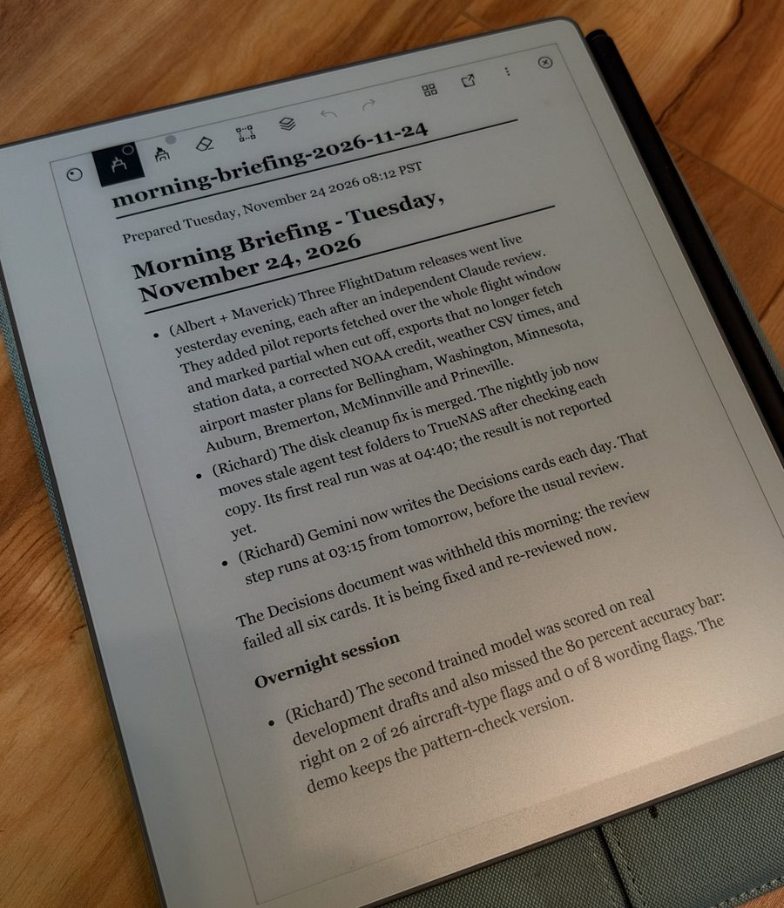
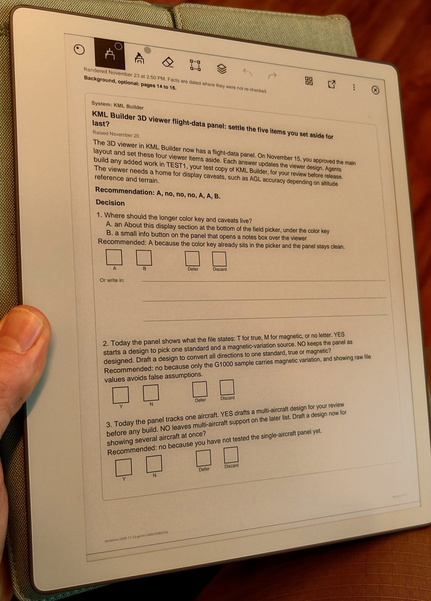

# rmk-brief-review

<p align="center"></p>

**The need:** I work with multiple agents in a complex team-like environment. I am the only 
human in the loop, and it can be a bit overwhelming to continually run at the 
pace and volume of the AI agents and highly-capable models that they run on. 
They don't need to eat or sleep, and their brains don't get tired. Sure, their 
context gets full, but we humans don't have a reliaable "/compact" or "/clear" 
feature for our brains.

Sometimes we just need to slow down, or at least have a human-focused gate that lets 
us put the brakes on our part of the loop. The goal of this workflow is to allow 
agents to execute while pushing questions to me (or you) in a way that allows 
and helps me (you) to slow down, stop, and think on our own terms.

**What it is:** A daily paper-like loop between a person with a reMarkable tablet and the
software (or agents) working for them:

- **Briefs.** Markdown becomes a clean, tablet-sized PDF and lands in a
  `/Briefs` folder. Old briefs rotate into `Previous Briefs` on their own.
- **A Decisions document.** Open questions are written as *decision cards* in a
  plain Markdown queue. Every morning they are verified, rewritten to a quality
  standard by one model, judged by a different model, and delivered as a PDF
  with real answer boxes: yes/no, lettered choices, write-in lines, Defer and
  Discard.
- **Answers by pen.** The reader ticks boxes and writes notes on the tablet,
  then tags the document `ready`. A watcher reads the ink, records every answer
  against the question it belongs to, and builds a follow-up document holding
  only what is still open.

An independent reviewer does their review before documents are passed to the tablet, 
nothing that was previously answered is asked again, and nothing on the tablet is ever 
hard-deleted.

This repository is my working system. I cleaned it up so it can run on anyone's
Mac. It was built and run daily for months by one person and a small team of
AI agents; the rules in it (and in [CARD-WRITING.md](CARD-WRITING.md)) are the
ones that survived contact with a real reader. The rules and prompts are in desperate 
need of an edit, which is on my list  of things to do. Once I complete that, I will 
update the repo and keep it up to date.

## Contents

- [How it works](#how-it-works)
  - [1. Briefs](#1-briefs)
  - [2. The Decisions document](#2-the-decisions-document)
  - [3. Writer, then an independent reviewer](#3-writer-then-an-independent-reviewer)
  - [4. Answering by pen](#4-answering-by-pen)
  - [5. The daily schedule](#5-the-daily-schedule)
- [Setup](#setup)
- [Configuration](#configuration)
- [Hooks: wiring notifications](#hooks-wiring-notifications)
- [Command reference](#command-reference)
- [Safety properties](#safety-properties)
- [Tests](#tests)
- [What changed from the original deployment](#what-changed-from-the-original-deployment)
- [Repository layout](#repository-layout)

## How it works

```
 queue (Markdown)                                   reMarkable tablet
 ───────────────                                    ─────────────────
 03:15  writer model rewrites changed cards  ┐
 03:30  preflight: render + review in a      │ fix cards before 05:00
        scratch copy, report problems        ┘
 05:00  verify -> render PDF -> independent
        reviewer -> hash-bound receipt
 06:00  receipt matches the bytes? ───────────────► /Briefs/decisions-DATE
        morning brief ────────────────────────────► /Briefs/morning-briefing-DATE
        one outcome line to the reader (hook)
                                                    reader pens answers,
 every 2 min  watcher sees "ready" + new ink ◄───── tags the document "ready"
        -> read strokes -> resolve to boxes
        -> record answers in the queue and state
        -> unclear mark? ask the reader (hook)
 any time  decisions-loop render/deliver:
        follow-up with only the open questions ───► replaces it; old one filed
```

### 1. Briefs

<p align="center"></p>

`remarkable/push-brief.sh notes.md` renders Markdown to PDF and uploads it with
[rmapi](https://github.com/ddvk/rmapi).

- **Two page formats.** `--paper tablet` (default) uses `brief.css`: a
  157 x 209 mm page that matches the tablet's screen, e-ink friendly type, a
  wide right margin for pen notes. `--paper letter` uses `print-letter.css`
  (US Letter, 11 pt, tables kept whole) for anything that will also be
  printed: a tablet-shaped PDF printed on Letter comes out with huge type and
  cut-off tables. Letter PDFs read fine on the tablet.
- **Two engines.** `chrome` (default): pandoc turns Markdown into HTML and
  headless Google Chrome prints it to PDF. This needs `pandoc` and Chrome
  installed; Chrome runs headless and never opens a window. `reportlab`: pure
  Python templates (`templates/brief.py`, `templates/review-doc.py` for wide
  margin-note reviews), no browser, US Letter. It does not draw tables.
- **Safe replacement.** A same-name document is never silently overwritten.
  `--replace` first archives the old copy (raw `.rmdoc` plus any annotated PDF)
  to `{archive}/replaced/`, then moves it to the tablet's trash (recoverable),
  then uploads. Two same-name copies stop the run. Decisions documents are
  refused outright; they have their own path.
- **Verified at the real surface.** After upload the folder is listed again and
  the run fails unless the document is really there. (A successful upload
  message has meant an empty document before. To prove content, pull it back
  and extract text; see [Verifying a push](#verifying-a-push).)
- **Rotation.** `rotate-briefs.sh` (run by the 06:00 job) moves yesterday's
  daily brief into `Previous Briefs`, files any other document only once the
  reader has tagged it `Marked as Read` (the reader's read receipt, which the
  automation never sets or clears), harvests annotations first, and prunes only
  daily briefs older than `keep_days`. Decisions documents are never pruned.

`push-to-remarkable.sh` is the simple no-browser path: Markdown through the
reportlab templates, or an existing PDF, straight to a folder.

### 2. The Decisions document

<p align="center"></p>

The queue is a Markdown file. Each open decision is one table row under a
heading starting with `## Active`:

```
| Item | Project | Age | Ask |
| --- | --- | --- | --- |
| Choose where the spare bicycle goes for the winter | Garage | 2026-01-10 | The spare bicycle blocks the garage door ... Recommendation: hang it on a wall hook. Decide: (1:bike_spot) [choice: A = wall hook in the garage, B = the shed, C = sell it this month] Where should the spare bicycle go? Recommended: A because a hook costs 15 dollars and frees the door at once. Row: spare_bike Read: readings/spare-bike.md |
```

Each question has a stable key (`bike_spot`) and an answer form:
`[yes/no]`, `[choice: A = ..., B = ...]` or `[write-in]`. Every question also
gets **Defer** and **Discard** boxes. `Read:` names a document that is printed in
full behind the card. The full format, and the reasons behind every rule, are
in **[CARD-WRITING.md](CARD-WRITING.md)**.

Rendering happens in two steps:

1. **`verify-queue.py`** checks every Active row before anything renders.
   It runs the renderer's own card-contract parser (so a row that passes can
   never fail at render time), checks every linked file exists, rejects
   duplicate row keys, re-runs any `Facts:` verifier for dated claims,
   optionally checks cited tickets are still open, and optionally checks a
   phone question service so nothing is asked on two surfaces. Failing rows
   are **held**: left off the document, named on its cover page with a plain
   reason, and kept in the queue.
2. **`today_page.py generate`** renders the PDF with reportlab and writes a
   **manifest**: the exact coordinates of every answer box, a page id, the
   layout version, source hashes, and an integrity hash. The pen reader later
   resolves ink against this manifest, so geometry is never guessed. The
   renderer also refuses to print any question with a recorded answer and
   stops the whole document if the answer record cannot be read: a document
   that might re-ask an answered question is worse than no document.

Exit codes from `push-decisions.sh` worth knowing: `5` nothing to ask today
(not a failure), `3` rows exist but every one was held (the empty-document
tripwire; nothing is pushed), `4` no valid review receipt, `7` a printed
question is live on the phone question service.

**Real-world examples.** [examples/real-world/](examples/real-world/) holds the actual
Decisions document and morning briefing delivered to the tablet on November 1, 2026,
as delivered, with two name changes (a person's first name and the name of a
scholarship award):

- [decisions-2026-11-01.pdf](examples/real-world/decisions-2026-11-01.pdf): 30 pages,
  10 cards (agent message bus access, a rules-file fix, Node and Python version
  cleanup on the Macs, and seven design decisions for a scholarship web portal),
  each followed by the reading printed behind it.
- [morning-briefing-2026-11-01.pdf](examples/real-world/morning-briefing-2026-11-01.pdf):
  the overnight report from the agent team, including a local inference engine
  comparison on the lab's GPU servers.

The scholarship figures in the Reports reading are staging test data. A small
worked example with invented cards is in [examples/](examples/), with the PDF it
renders.

### 3. Writer, then an independent reviewer

**The writer** (`writer/author.py`, 03:15) sends new or changed cards to a
model with the card standard (`writer/instructions.md`) and gets back a JSON
rewrite. The row key, every question key, every answer form and the trailing
evidence links are preserved exactly; only wording changes. Every rewritten
row must pass `verify-queue.py` or the original stays. Answered and discarded
cards are never touched; deferred cards are rewritten (a deferred card is one
the reader would not answer as written). A ledger of row hashes means each
version of a row is rewritten once.

**The reviewer** (`scheduled-review.sh`, 05:00) is a different model that did
not write the cards. It receives page images of the rendered PDF (via
`pdftoppm`) and the manifest, and judges every card on three tests:

- **complete_context**: can the reader decide from this card alone, without
  the deciding points buried under material that does not change the choice?
- **forms_fit**: do the answer boxes fit the questions?
- **plain_english**: is it written for a busy human, decision first, short
  concrete sentences, not specification or model-output register?

The reviewer records its verdicts with `review-receipt.py write`, which writes a
**receipt bound by SHA-256 to the exact PDF and manifest**. The delivery
refuses to push unless `review-receipt.py check` passes: the receipt exists,
names a reviewer who is not the producer, matches both hashes, and every card
passed all three tests. Any re-render after the review changes the hash and
voids the receipt, so the reviewed bytes are the only bytes that can ship.

The review itself is isolated: the reviewer only ever sees read-only copies in
a staging folder; the real PDF and manifest are hashed before and after and
must not change; the receipt is checked against the real files, then published
atomically and checked again. It runs under a timeout and a cutoff time so it
can never collide with the 06:00 delivery. Every failure path alerts and
publishes nothing.

**The preflight** (`scheduled-review-preflight.sh`, 03:30) runs that whole
review against a throwaway copy of the archive, seeded read-only with the real
answer history so it renders exactly what 05:00 will render, publishes
nothing, and sends one alert listing failing cards and held rows, early enough
to fix them.

The reviewer prompt is `remarkable/reviewer-prompt.md`.

### 4. Answering by pen

The reader answers on the tablet: a tick in a box, a letter, words on a
write-in line, a note in the margin. Then the reader tags the document
**`ready`** (the done-annotating signal).

`annotation-watch.sh` runs every two minutes:

1. **`check-annotations.sh`** lists the watched folders through rmapi and
   compares each document's modified time, ink hash and tags against the
   last run. Only a document carrying `ready` with new ink fires; untagged
   ink is logged quietly, and anything under `Previous Briefs` never fires
   (moving a document back into Briefs is how the reader asks for a re-read).
   An unreadable listing keeps the old state rather than deleting it.
2. For a registered Decisions document, **`today_watch.py`** downloads the raw
   document and **`today_page.py process-archive`** reads the v6 pen strokes
   with [rmscene](https://github.com/ricklupton/rmscene), maps them onto PDF
   coordinates, and resolves each mark to the box it sits in. Marks that are
   too large, cross two boxes, or select two answers are never guessed; they
   become ambiguities. Handwriting outside the boxes is cropped to PNG files so
   a person or a vision model can read it.
3. **The consumer** (`consume_decisions.py` with `decision_consumer_v3.py`)
   records each answer: **answered** (the row is closed in the queue, under a
   dated "Pen dispositions" section), **deferred** (off today, back tomorrow
   unchanged), **discarded** (never asked again), or **needs clarification**
   (a mark it cannot read safely; the reader gets a same-day question through
   the notify hook, and nothing is acted on until they answer). The queue
   write is a locked compare-and-swap with a journal, so a crash at any point
   recovers cleanly.
4. The **on_annotation hook** then receives the changed paths and the
   deterministic result, for whoever handles notes and questions the reader
   wrote (in the original deployment, an orchestrating agent).

**The follow-up** (`decisions-loop.sh`):

- `render` refuses until the document on the tablet has been consumed (exit
  11) and until every penned question, note, unclear mark and extra inked page
  has been answered (exit 12). Answers are recorded in
  `{archive}/decisions/DATE/answers-complete.json`:
  `{"tool":"rmw-decisions-answers-v1","page_id":"<id>","answered_by":"<who>","answered_at":"<iso>","handled":[...]}`.
  It then renders only what remains, unreviewed.
- The reviewer reviews it (same receipt gate).
- `deliver` pushes those exact bytes. The previous document is moved to
  `Previous Briefs` with its ink intact, leaving exactly one Decisions document
  in `/Briefs`.
- When nothing remains, `render` exits 13 and `file-processed` files the
  answered document instead of pushing a blank one.

Every command takes `--dry-run`, which swaps rmapi for a stub over a fixture
folder that refuses `rm` and logs every call, while running the real gates.

### 5. The daily schedule

`install_launchd.py` writes one launchd job per step (macOS):

| Time (default) | Job | Script |
|---|---|---|
| 03:15 | writer (only when `writer.command` is set) | `writer/author.py --apply` |
| 03:30 | preflight | `scheduled-review-preflight.sh` |
| 05:00 | review | `scheduled-review.sh` |
| 06:00 | morning delivery | `morning-dashboard.sh` |
| 07:00 | outcome dead-man | `morning-outcome-deadman.sh` |
| 07:15 | pen-chain probe | `pen_chain_probe.py` |
| every 120 s | annotation watch | `annotation-watch.sh` |

**Morning delivery** (`morning-dashboard.sh`, named for historical reasons)
attempts every deliverable and never lets one failure stop another: a tablet
write probe, the Decisions document (reviewed bytes only, `--no-generate`),
then the morning brief from the `## Morning Briefing` section of the night's
briefing file (waiting up to 45 minutes for a late file, never inventing one)
plus calendar, service health and weather, then rotation. It sends exactly
**one outcome line** to the reader through the notify hook, success or
failure, and component detail to operators through the alert hook. Nothing
leaves the script unless `MB_ALLOW_OUTBOUND=1` is set (the launchd job sets
it), so a test run can never message anyone. The 07:00 dead-man alerts
operators if that outcome line was not confirmed. The pen-chain probe asks one
end-to-end question each morning: did every inked Decisions document in the
last day produce a resolution and recorded answers?

## Setup

Requirements: macOS (launchd, BSD `date`, `lockf`; the scripts are bash 3.2
compatible), Python 3.11+, [rmapi](https://github.com/ddvk/rmapi) paired with
your reMarkable cloud account, and Poppler (`pdftoppm`, `pdftotext`). For the
Chrome brief engine: `pandoc` and Google Chrome. For the model steps: the CLIs
of the models you choose (the defaults assume the Codex CLI for review).

```bash
git clone https://github.com/greghughespdx/rmk-brief-review.git
cd rmk-brief-review
python3 -m venv .venv
.venv/bin/pip install -r requirements.txt          # requirements-dev.txt adds pytest
brew install poppler pandoc                          # pandoc only for the chrome engine

mkdir -p ~/.config/remarkable-workflow
cp config.example.toml ~/.config/remarkable-workflow/config.toml
# edit: tablet folders, rmapi path, writer and reviewer commands, hooks

.venv/bin/python remarkable/rmw_config.py init      # folders + a starter queue
.venv/bin/python remarkable/rmw_config.py show      # what will actually be used

examples/build-example.sh                            # render the worked example
remarkable/push-brief.sh examples/brief.md --pdf-only /tmp/brief.pdf
```

Then add cards to your queue, run `remarkable/push-decisions.sh` to render
locally (it stops before pushing), review, and push with
`remarkable/push-decisions.sh --no-generate --push`. When the manual loop
works, `.venv/bin/python remarkable/install_launchd.py` writes the jobs to
`./launchd-out/` for you to read, and `--install` loads them.

rmapi keeps its own device token after pairing. Treat that file as a secret:
never commit it or copy it into this repository.

### Verifying a push

An upload that "succeeded" is not proof the reader has a readable document.
Pull it back and read it:

```bash
cd "$(mktemp -d)"
rmapi get "/Briefs/morning-briefing-$(date +%F)"
unzip -q *.rmdoc -d unpacked
pdftotext "$(find unpacked -name '*.pdf' | head -1)" - | head -20
```

Do not judge by `pageCount` in the `.content` file: a pushed PDF reports
`pageCount: 0` until the tablet first opens it.

## Configuration

One TOML file holds every setting; see
**[config.example.toml](config.example.toml)** for each key with its default
and a comment. Lookup order: `$RMW_CONFIG`, `./remarkable-workflow.toml`,
`~/.config/remarkable-workflow/config.toml`. Any key can be overridden by an
environment variable `RMW_<SECTION>_<KEY>`. Python tools read it through
`remarkable/rmw_config.py`; shell scripts through `remarkable/rmw-env.sh`.

The settings a new user must look at: `tablet.briefs_folder`,
`tablet.previous_folder`, `tablet.rmapi`, `writer.command` and
`reviewer.command`. Everything else has a working default.

Other environment variables the scripts honor (useful in tests and one-off
runs): `RMAPI` and `RMAPI_REAL` (the rmapi wrapper and the real binary),
`REMARKABLE_TODAY_ARCHIVE` (point a run at a scratch archive),
`REMARKABLE_DOC_PRODUCER`, `MB_ALLOW_OUTBOUND`, `MB_DRY_RUN`, the
`RMAPI_LOG*` and `RMAPI_THROTTLE*` knobs in `rmapi-retry.sh`, and
`PHONE_CARDS_URL` / `PHONE_CARDS_VERIFY_TOKEN` / `PHONE_CARDS_TOKEN_COMMAND`
for the optional phone question service.

## Hooks: wiring notifications

Every outbound message goes through one of five hooks, each an argv in
`[hooks]`. Unset hooks are no-ops; an unset `notify` or `page` reports "not
delivered" so nothing is recorded as sent that was not.

| Hook | Called with | Used for |
|---|---|---|
| `alert` | subject, body, slug | operator alerts: render, review or delivery failures |
| `notify` | message | the reader: the morning outcome line, questions about unclear pen marks |
| `page` | `--title --body --level --source` | urgent operator push (pen chain broken) |
| `on_annotation` | subject, body, paths... | a `ready` document got new ink |
| `ticket_status` | (none) | prints `{"ID": "open"}` JSON for the ticket check |

Working examples in `remarkable/hooks/examples/`: `agent-bus-send.py` (a
durable HTTP message bus that an AI agent reads, the original deployment's
wiring), `push-notify.sh` (an ntfy-style phone push), `macos-imessage.sh`
(Messages.app to yourself) and `log-to-file.sh` (see what would be sent).
Keep tokens in environment variables or a secret store, never in the config.

## Command reference

| Command | What it does |
|---|---|
| `push-brief.sh FILE.md [--paper tablet\|letter] [--engine chrome\|reportlab] [--dest F] [--replace] [--pdf-only OUT]` | render and push a brief |
| `push-to-remarkable.sh FILE [/Folder] [--template brief\|review-doc]` | reportlab brief, or push a PDF |
| `rotate-briefs.sh [--keep-days N]` | file and prune briefs |
| `verify-queue.py --out-queue F --report F [--render-date D]` | verify the queue |
| `push-decisions.sh [--date D] [--push] [--no-generate] [--name N]` | render, gate, deliver |
| `review-receipt.py check\|write --date D ...` | the hash-bound review receipt |
| `scheduled-review.sh [--date D]` / `scheduled-review-preflight.sh` | the independent review |
| `writer/author.py --dry-run-out F \| --apply` | the writer step |
| `decisions-loop.sh status\|render\|deliver\|file-processed --date D [--dry-run]` | the follow-up loop |
| `annotation-watch.sh` / `check-annotations.sh [--baseline]` | the pen watcher |
| `unset-ready-tag.sh /path` | record a document's current ink as processed (never touches the tablet) |
| `rotate-decisions.sh --date D` | keep one Decisions document in Briefs |
| `morning-dashboard.sh` | the 06:00 delivery |
| `card_premise_watch.py snapshot\|check` | detect a card whose premise changed after review |
| `pen_chain_probe.py` | the daily end-to-end pen check |
| `render-archived-notes.py` | backfill note crops for old processed pages |
| `install_launchd.py [--install]` | the launchd jobs |
| `rmw_config.py show\|init\|get\|hook` | configuration |

All paths are relative to `remarkable/`.

## Safety properties

These are enforced in code and pinned by tests, most with negative controls
that turn the suite red when the guard is removed:

- **Nothing unreviewed ships.** The push requires a receipt from a reviewer
  other than the producer, bound by hash to the exact PDF and manifest.
- **Nothing answered is asked again.** The renderer reads the answer record
  and question state; if it cannot read them, it renders nothing.
- **Nothing stale prints.** Held rows stay off the page with a reason on the
  cover; dated facts are re-verified at every render.
- **Nothing is hard-deleted on the tablet.** Retired documents are moved to
  `Previous Briefs` or the tablet trash (`rmapi mv`, recoverable), never
  `rmapi rm`, except daily briefs pruned after `keep_days`. A document with
  ink is never trashed. A document that cannot be read is left in place.
- **Ink is archived before anything is replaced.** A registered Decisions
  document is not replaced until its ink has been harvested.
- **The reader's tags are the reader's.** `ready` and `Marked as Read` are
  read, never set or cleared, by automation.
- **Cloud rate limits are absorbed.** Every rmapi call goes through
  `rmapi-retry.sh` (bounded retry on HTTP 429, honoring Retry-After, one log
  line per attempt, optional shared throttle).
- **Test runs cannot reach anyone.** Morning delivery is outbound-off unless
  explicitly enabled; dry runs refuse `rm`.

## Tests

```bash
.venv/bin/pip install -r requirements-dev.txt
.venv/bin/python -m pytest
```

The suite runs offline and hermetically (`tests/conftest.py` ignores any
config file and empties every hook). It includes the Python tests and, through
`tests/test_shell_suites.py`, the shell suites that sit next to the scripts
(`remarkable/test-*.sh`), which drive the real scripts against a fake rmapi
over a fixture device tree. The phone-service tests start a local HTTP
server; under a network sandbox, pin its port with `RMW_TEST_HTTP_PORT` and
allow that port.

## What changed from the original deployment

The original ran inside a private multi-project repository. For publication:

**Generalized into config** (`config.example.toml`): the tablet folders, the
rmapi binary, the writer and reviewer model commands, every local path (queue,
archive, registry, logs), the briefing source and its calendar, health and
weather sources, the launchd label prefix and job times, the ticket id
pattern, and all notifications (now hooks with no-op defaults).

**Kept as optional hooks, off by default:** the agent message bus (alerts and
annotation hand-off; `hooks/examples/agent-bus-send.py`), the urgent phone
push service (`page`), iMessage to the reader (`notify`), the ticket tracker
check (beads `bd export`, or any `ticket_status` command), the phone question
service cross-check (`PHONE_CARDS_URL`), the Google Calendar fetch.

**Removed:**

- Lab-specific plumbing: the hard-coded bus, iMessage and push helpers, a
  secrets-manager lookup for the bus and phone-service tokens (tokens now come
  only from the environment or a command you configure), internal host
  addresses, and machine-specific interpreter paths.
- Checked-in launchd plists naming one machine's paths (now generated by
  `install_launchd.py`).
- Tools for one-off or unrelated documents: a duty-officer worksheet extractor
  and its device-template installers, per-day "facts" verifier scripts written
  for specific real cards, and the original sample decision sheets.
- All real content: Decisions documents, the pen-answer archive, the review
  queue, card text, and every test that replayed them. The tests that remain
  use invented fixtures; geometry fixtures keep only box coordinates.
- People's names. The reader is "the reader"; the original agents are "the
  orchestrator" and "the cross-reviewer" where comments record why a rule
  exists.

**Rewritten:** the card standard as a standalone guide (CARD-WRITING.md, with
the reasoning and without personal quotes or dates), the reviewer and writer
prompts in the same voice, the scheduled-review reviewer invocation (a
configurable command alongside the built-in Codex call), the writer (any
stdin/stdout model CLI, or the Gemini agy protocol; git publishing optional;
its authoring window follows `schedule.writer`), and this README.

Comments in the code still carry dates and internal ticket ids (`mc-xxxx`).
They record when and why each guard was added and were left in place. Where
comments and messages say `REVIEW-QUEUE.md`, read "the queue file": that was
its name in the original deployment.

## Repository layout

```
README.md  CARD-WRITING.md  config.example.toml  LICENSE
requirements.txt  requirements-dev.txt  pyproject.toml
examples/
  decisions-queue.md      three invented cards (yes/no, choice, multi-question)
  readings/               the documents printed behind each card
  facts/check_reading.py  an example Facts verifier
  build-example.sh        renders the example with the repository's own code
  brief.md                an invented brief
  output/                 decisions-2026-01-15.pdf, its manifest, brief-example.pdf
  real-world/             the Decisions document and morning briefing from 2026-11-01, as delivered
remarkable/
  rmw_config.py rmw-env.sh               configuration
  push-brief.sh push-to-remarkable.sh brief.css print-letter.css templates/
  rotate-briefs.sh rotate-decisions.sh rmapi-retry.sh tag_flags.py
  verify-queue.py today_page.py review-receipt.py push-decisions.sh
  replace-decisions-document.sh check_harvest_receipt.py live-card-delivery-check.py
  writer/author.py writer/instructions.md reviewer-prompt.md
  scheduled-review.sh scheduled-review-preflight.sh
  check-annotations.sh annotation-watch.sh today_watch.py unset-ready-tag.sh
  consume_decisions.py decision_consumer_v3.py decision_resolver_v3.py question_state.py
  decisions-loop.sh card_premise_watch.py render-archived-notes.py pen_chain_probe.py
  morning-dashboard.sh generate-dashboard.py morning-outcome-deadman.sh
  morning-status-watch.sh verify-morning-launchagents.sh install_launchd.py
  hooks/ (alert.sh notify.sh page.sh examples/)
  test-*.sh               shell suites, run by tests/test_shell_suites.py
tests/                    pytest suites and invented fixtures
```

`today_page.py` is the Decisions renderer and pen resolver; the name is
historical (it began as a one-page "Today" sheet).

## License

MIT. See [LICENSE](LICENSE). The test fixture font
(`tests/fixtures/remarkable/specimen-font/Vera.ttf`) is Bitstream Vera, under
its own license in the same folder.
